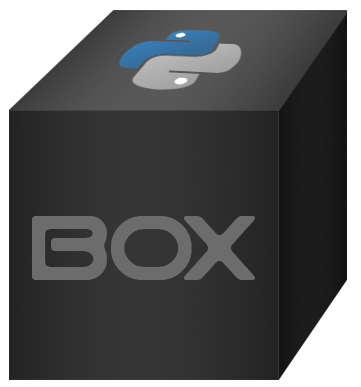

|BuildStatus| |License|

|BoxImage|

.. code:: python

        from box import Box

        movie_box = Box({ "Robin Hood: Men in Tights": { "imdb stars": 6.7, "length": 104 } })

        movie_box.Robin_Hood_Men_in_Tights.imdb_stars
        # 6.7

Box will automatically make otherwise inaccessible keys safe to access as an attribute.
You can always pass `conversion_box=False` to `Box` to disable that behavior.
Also, all new dict and lists added to a Box or BoxList object are converted automatically.

There are over a half dozen ways to customize your Box and make it work for you.

Check out the new `Box github wiki <https://github.com/cdgriffith/Box/wiki>`_ for more details and examples!

Install
=======

**Version Pin Your Box!**

If you aren't in the habit of version pinning your libraries, it will eventually bite you.
Box has a `list of breaking change <https://github.com/cdgriffith/Box/wiki/Major-Version-Breaking-Changes>`_ between major versions you should always check out before updating.

requirements.txt
----------------

.. code:: text

        python-box[all]~=8.0

As Box adheres to semantic versioning (aka API changes will only occur on between major version),
it is best to use `Compatible release <https://www.python.org/dev/peps/pep-0440/#compatible-release>`_ matching using the `~=` clause.

Install from command line
-------------------------

.. code:: bash

        python -m pip install --upgrade pip
        pip install "python-box[all]~=8.0" --upgrade

Install with selected dependencies
----------------------------------

Box does not install external dependencies such as yaml and toml writers. Instead you can specify which you want,
for example, `[all]` is shorthand for:

.. code:: bash

        pip install "python-box[ruamel.yaml,toml,msgpack]~=8.0" --upgrade

But you can also sub out `ruamel.yaml` for `PyYAML`. To use ``tomli-w`` for TOML output,
select the ``tomli`` extra instead of ``toml``.

Check out `more details <https://github.com/cdgriffith/Box/wiki/Installation>`_ on installation details.

Box 8 is tested on python 3.11+, if you are upgrading from previous versions, please look through
`any breaking changes and new features <https://github.com/cdgriffith/Box/wiki/Major-Version-Breaking-Changes>`_.

Optimized Version
-----------------

Box has introduced Cython optimizations for major platforms by default.
Loading large data sets can be up to 10x faster!

If you are **not** on a x86_64 supported system you will need to do some extra work to install the optimized version.
There will be an warning of "WARNING: Cython not installed, could not optimize box" during install.
You will need python development files, system compiler, and the python packages `Cython`, `setuptools` and `wheel`.

**Linux Example:**

First make sure you have python development files installed (`python3-dev` or `python3-devel` in most repos).
You will then need `Cython`, `setuptools` and `wheel` installed and then install (or re-install with `--force`) `python-box`.
As Cython is not a build requirement, the build has to run without isolation so it can see your installed copy.

.. code:: bash

        pip install Cython "setuptools>=77" wheel
        pip install "python-box[all]~=8.0" --upgrade --force --no-binary python-box --no-build-isolation

If you have any issues please open a github issue with the error you are experiencing!

Overview
========

`Box` is designed to be a near transparent drop in replacements for
dictionaries that add dot notation access and other powerful feature.

There are a lot of `types of boxes <https://github.com/cdgriffith/Box/wiki/Types-of-Boxes>`_
to customize it for your needs, as well as handy `converters <https://github.com/cdgriffith/Box/wiki/Converters>`_!

Keep in mind any sub dictionaries or ones set after initiation will be automatically converted to
a `Box` object, and lists will be converted to `BoxList`, all other objects stay intact.

Check out the `Quick Start <https://github.com/cdgriffith/Box/wiki/Quick-Start>`_  for more in depth details.

`Box` can be instantiated the same ways as `dict`.

.. code:: python

        Box({'data': 2, 'count': 5})
        Box(data=2, count=5)
        Box({'data': 2, 'count': 1}, count=5)
        Box([('data', 2), ('count', 5)])

        # All will create
        # <Box: {'data': 2, 'count': 5}>

`Box` is a subclass of `dict` which overrides some base functionality to make
sure everything stored in the dict can be accessed as an attribute or key value.

.. code:: python

      small_box = Box({'data': 2, 'count': 5})
      small_box.data == small_box['data'] == getattr(small_box, 'data')

All dicts (and lists) added to a `Box` will be converted on insertion to a `Box` (or `BoxList`),
allowing for recursive dot notation access.

`Box` also includes helper functions to transform it back into a `dict`,
as well as into `JSON`, `YAML`, `TOML`, or `msgpack` strings or files.

Internal Attributes on Subclasses
---------------------------------

If you subclass `Box` and need attributes that are *not* part of the data (a source path, a cache, a
logger...), list their names in ``_box_internal_attrs``. Setting or deleting those names with attribute access
stores them on the instance, like a normal Python object, instead of in the dictionary.

.. code:: python

        from box import Box

        class Config(Box):
            _box_internal_attrs = ("source_path", "_cache")

            def __init__(self, *args, source_path=None, **kwargs):
                super().__init__(*args, **kwargs)
                self.source_path = source_path
                self._cache = {}

        c = Config({"name": "app"}, source_path="/etc/app.yml")
        c.source_path        # '/etc/app.yml'
        c.to_dict()          # {'name': 'app'}
        "source_path" in c   # False

Internal attributes are excluded from ``to_dict``, ``to_json``, ``to_yaml``, ``to_toml``, ``to_msgpack``, ``keys()``,
iteration, ``in``, ``len``, equality and hashing. They survive ``pickle``, and are carried over by ``copy()``,
``copy.copy`` (shared, shallow) and ``copy.deepcopy`` (deep copied). They can be set and deleted even on a
``frozen_box``, since they are not data.

Things to keep in mind:

* Nested boxes are created through your subclass (as `box_class` defaults to it), so every nested box gets its
  own fresh internal attributes from ``__init__``, they are not shared with the parent.
* Only attribute access is affected. ``c["source_path"]`` still refers to the dictionary data, and if a data key
  and an internal attribute share a name, attribute access returns the internal attribute.

Thanks
======

A huge thank you to everyone that has given features and feedback over the years to Box! Check out everyone that has contributed_.

A big thanks to Python Software Foundation, and PSF-Trademarks Committee, for official approval to use the Python logo on the `Box` logo!

Also special shout-out to PythonBytes_, who featured Box on their podcast.

License
=======

MIT License, Copyright (c) 2017-2026 Chris Griffith. See LICENSE_ file.

.. |BuildStatus| image:: https://github.com/cdgriffith/Box/workflows/Tests/badge.svg?branch=master
   :target: https://github.com/cdgriffith/Box/actions?query=workflow%3ATests
.. |License| image:: https://img.shields.io/pypi/l/python-box.svg
   :target: https://pypi.python.org/pypi/python-box/

.. _PythonBytes: https://pythonbytes.fm/episodes/show/19/put-your-python-dictionaries-in-a-box-and-apparently-python-is-really-wanted
.. _contributed: AUTHORS.rst
.. _`Wrapt Documentation`: https://wrapt.readthedocs.io/en/latest
.. _reusables: https://github.com/cdgriffith/reusables#reusables
.. _created: https://github.com/cdgriffith/Reusables/commit/df20de4db74371c2fedf1578096f3e29c93ccdf3#diff-e9a0f470ef3e8afb4384dc2824943048R51
.. _LICENSE: https://github.com/cdgriffith/Box/blob/master/LICENSE
